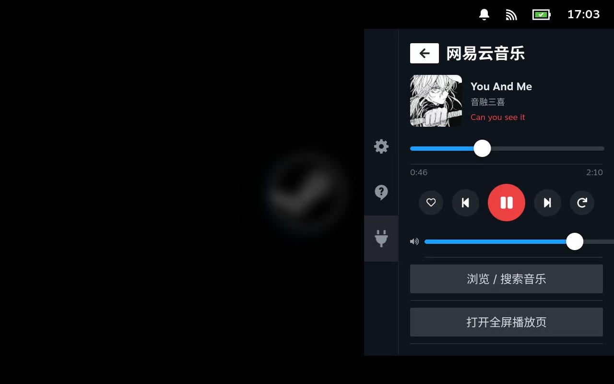
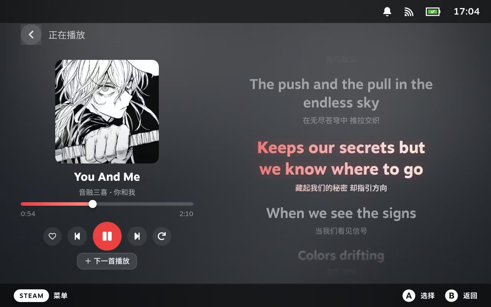
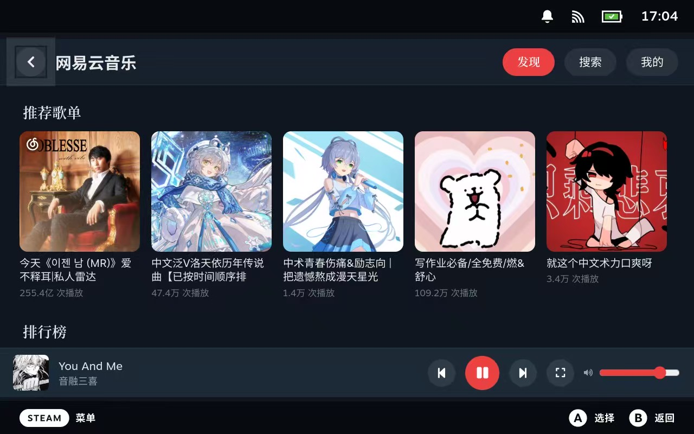
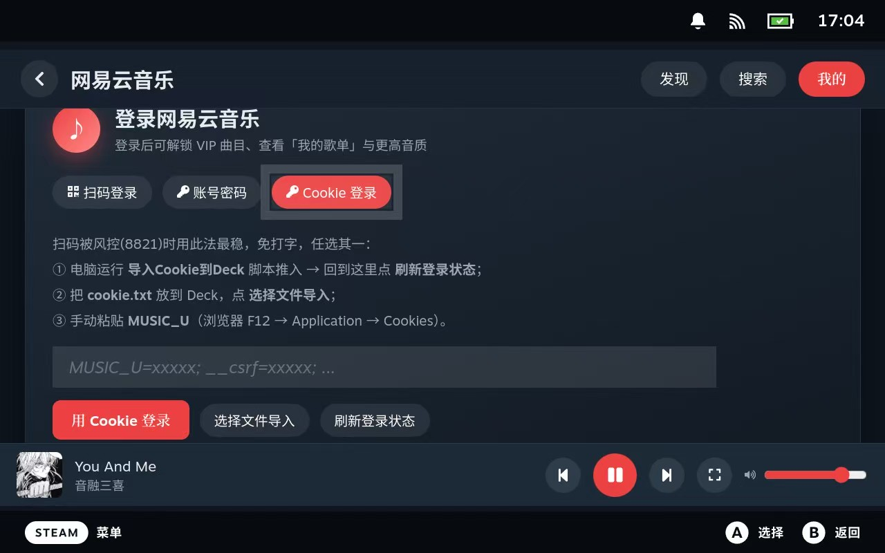

# NetEase Cloud Music · Steam Deck Decky Loader Plugin

[简体中文](README.md) · **English**

Search, browse and play NetEase Cloud Music (网易云音乐) right from Steam Deck's **Game Mode**, via the **Quick Access Menu (QAM, the ··· menu)**, plus a **Folia-style full-screen immersive lyrics page**.

UI reference: [MusicControl](https://github.com/martinpl/MusicControl); lyric motion & login risk-control reference: [folia-major](https://github.com/chthollyphile/folia-major) and its `NeteaseCloudMusicApiEnhanced`.

- 📦 Download: [Releases](https://github.com/fotlim/decky-netease-music/releases)
- 📘 Dev guide: [docs/SteamOS-Decky插件开发指南.md](docs/SteamOS-Decky插件开发指南.md)

---

## 📷 Screenshots

| QAM control panel | Full-screen player |
| :---: | :---: |
|  |  |

| Library · Discover | Login · Cookie import |
| :---: | :---: |
|  |  |

---

## ✨ Features

- **QAM control panel**: cover, title/artist, scrolling lyrics, progress, previous/play/next, volume, play mode (repeat-all / in-order / repeat-one / shuffle).
- **Full-screen library** (Discover / Search / Mine):
  - Discover: recommended playlists, charts, new songs
  - Search: songs / playlists / albums / artists; **pinyin live suggestions** (`zhoujielun → 周杰伦`) + hot/history chips
  - Playlist / album / artist details; Mine: login, my playlists, audio quality
- **Full-screen immersive player (Folia style)**: blurred/color-picked cover background with a Monet color + flowing-light effect; centered lyrics, current line enlarged & highlighted; word-by-word (yrc) karaoke highlighting; translation line; like/heart.
- **i18n**: default English, follows the system language (Chinese if system is Chinese), with a manual 中/EN toggle that is remembered.
- **Login**: QR / phone-email password / **Cookie login** (recommended: generate `cookie.txt` with `生成Cookie文件.exe`, then import).
- **Low overhead**: pure Python backend (only Decky's bundled aiohttp) + a singleton HTML5 audio; playback continues when QAM is closed.
- **Controller friendly**: all custom controls join the `Focusable` focus tree; D-pad / A works.
- **Diagnostic log**: `~/homebrew/logs/decky-netease-music/netease-music.log`, with a "View logs" button in the UI.

> Copyright: this project only calls NetEase public APIs; no cracking or downloading. Playback depends on your account and copyrights.

---

## 🏗 Architecture

```
Frontend React(@decky/ui)  ──call(RPC)──▶  main.py (Decky backend)
 · QAM NowPlaying                     · lifecycle / error fallback / logs
 · Library (discover/search/mine)     · → netease.py
 · NowPlayingPage (Folia lyrics)      netease.py (stdlib + aiohttp, TLS verification)
 · player.ts (audio singleton/state)  · AES-128 + weapi/eapi, device-fingerprint cookies
```

- Audio is played directly by the frontend `<audio>` from the https CDN (singleton; keeps playing when QAM closes).
- Backend uses **aiohttp** (bundled with Decky loader) to avoid missing modules in PyInstaller's frozen env.

---

## 📁 Layout

```
(repo root is the plugin project)
├── plugin.json        # Decky manifest
├── main.py            # backend entry (RPC / fallback / logs)
├── netease.py         # NetEase client (AES + weapi/eapi)
├── package.json  rollup.config.js  tsconfig.json
├── src/               # frontend source
├── dist/index.js      # build output (needed by the install zip; not committed, generated at build)
├── docs/              # dev guide / screenshots
├── CHANGELOG.md  README.md  README.en.md  LICENSE
```

---

## 🔧 Build

```bash
pnpm install
pnpm build        # produces dist/index.js
pnpm typecheck    # optional
```

---

## 📦 Install

**Option A: Decky "Install from ZIP" (recommended)**
1. Download `decky-netease-music-decky.zip` from [Releases](https://github.com/fotlim/decky-netease-music/releases);
2. Decky Settings → Developer → **Install Plugin from ZIP File** and pick it.

**Option B: Manual copy**
Copy the plugin folder to `~/homebrew/plugins/decky-netease-music` and restart Decky (`sudo systemctl restart plugin_loader`).

> No Node required after install; no node_modules at runtime.

---

## 🎮 Usage

1. Open "网易云音乐" in QAM, tap "Browse / Search music" to enter the library;
2. After playback starts, tap **⤢** at the far right of the mini bar to open the full-screen player;
3. Search accepts **pinyin** (e.g. `qingtian`); use suggestions/hot words. Steam's virtual keyboard may not commit Chinese IME, so pinyin is the most reliable.

### Login
- **QR**: scan with the NetEase mobile app. If it says `8821 / please switch login method`, that's account/environment risk control — use Cookie instead.
- **Cookie (most reliable)**:
  1. On PC, double-click **`生成Cookie文件.exe`** → it opens a browser to the NetEase login page → after you log in it generates `cookie.txt`;
  2. Copy `cookie.txt` to the Deck (USB / file manager / shared folder) → plugin "Cookie login → Import file";
  3. Or place it at `~/homebrew/data/decky-netease-music/cookies.txt` then tap "Refresh login status".
- Most songs can be searched/played without login (128k); login unlocks VIP / my playlists / higher quality.

---

## ⚠️ Troubleshooting

- Errors are shown as **real messages**; you can also tap "View logs".
- Log: `~/homebrew/logs/decky-netease-music/netease-music.log`; system log: `sudo journalctl -u plugin_loader -n 200 --no-pager`.
- Restart Decky: `sudo systemctl restart plugin_loader.service`.

---

## 📄 License

MIT
