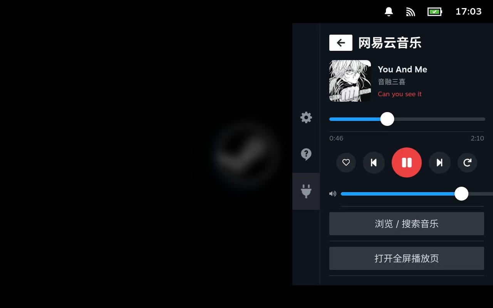
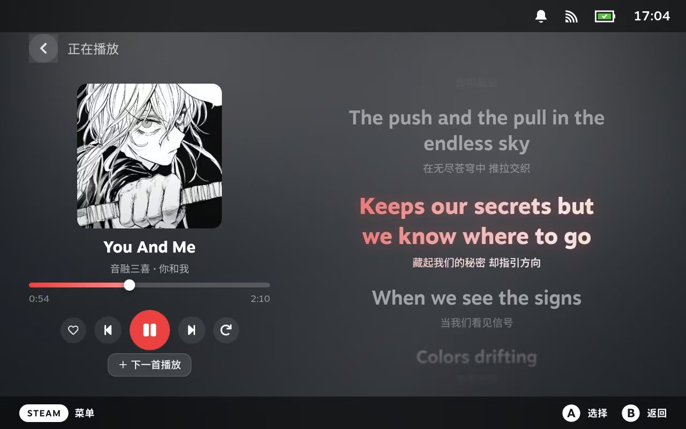
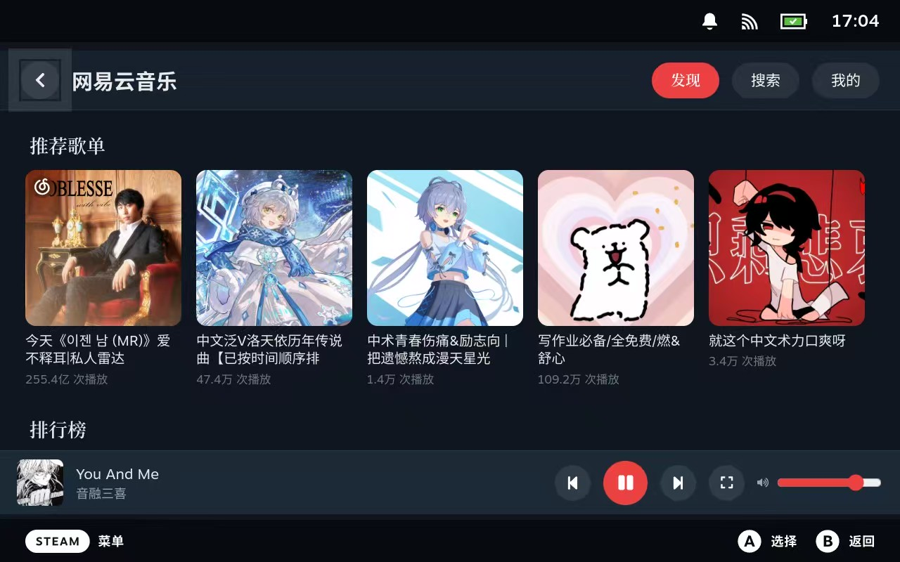
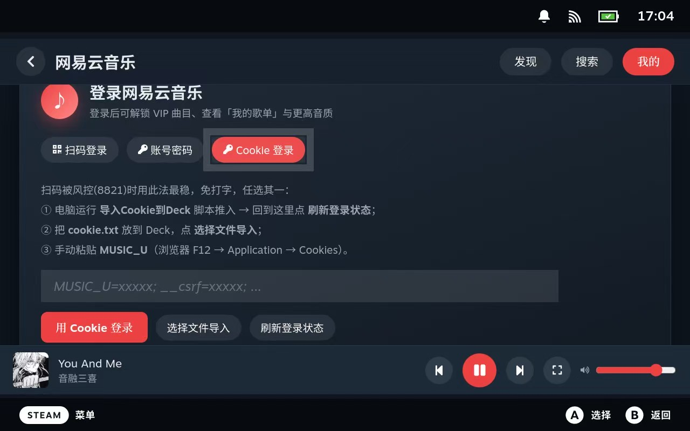

# 网易云音乐 · Steam Deck Decky Loader 插件

**简体中文** · [English](README.en.md)

在 Steam Deck 游戏模式（Game Mode）里，从 **Quick Access Menu（QAM，··· 菜单）** 搜索、浏览并播放网易云音乐；并提供 **Folia 风格的全屏沉浸式歌词页**。

界面参考 [MusicControl](https://github.com/martinpl/MusicControl)；歌词动效与登录风控处理参考 [folia-major](https://github.com/chthollyphile/folia-major) 及其底层 `NeteaseCloudMusicApiEnhanced`。

- 📦 下载安装包：[Releases](https://github.com/fotlim/decky-netease-music/releases)
- 📘 开发指南：[docs/SteamOS-Decky插件开发指南.md](docs/SteamOS-Decky插件开发指南.md)

---

## 📷 截图

| QAM 控制面板 | 全屏沉浸播放页 |
| :---: | :---: |
|  |  |

| 音乐库 · 发现 | 登录 · Cookie 导入 |
| :---: | :---: |
|  |  |

---

## ✨ 功能

- **QAM 控制面板**：封面、歌名/歌手、滚动歌词、进度、播放/上一首/下一首、音量、播放模式（列表循环/顺序/单曲/随机）。
- **全屏音乐库**（发现 / 搜索 / 我的）：
  - 发现：推荐歌单、排行榜、新歌推荐
  - 搜索：单曲 / 歌单 / 专辑 / 歌手；**拼音实时联想**（`zhoujielun → 周杰伦`）+ 热门/历史词条
  - 歌单 / 专辑 / 歌手详情；我的：登录、我的歌单、音质
- **全屏沉浸播放页（Folia 风）**：封面模糊取色 + 莫奈取色动态流光背景；歌词居中、当前行放大高亮、逐字歌词（yrc）卡拉OK点亮；翻译行；红心收藏。
- **多语言**：默认英文、跟随系统语言（系统为中文则中文），QAM/库头部可手动切换「中/EN」并记忆。
- **登录**：扫码 / 账号密码 / **Cookie 登录**（推荐用 `生成Cookie文件.exe` 自动生成 cookie.txt 后导入）。
- **低占用**：纯 Python 后端（仅依赖 Decky 自带 aiohttp）+ 单例 HTML5 音频，关闭 QAM 音乐继续。
- **手柄友好**：全部自定义控件接入 `Focusable`，D-pad/A 可操作。
- **诊断日志**：`~/homebrew/logs/decky-netease-music/netease-music.log`，界面可「查看诊断日志」。

> 版权：本项目仅调用网易云公开接口、不做破解或下载；能否播放取决于账号/版权。

---

## 🏗 架构

```
前端 React(@decky/ui)  ──call(RPC)──▶  main.py (Decky 后端)
 · QAM NowPlaying                     · 生命周期 / 错误兜底 / 诊断日志
 · Library（发现/搜索/我的）           · → netease.py
 · NowPlayingPage（Folia 歌词）         netease.py（标准库 + aiohttp，TLS 证书校验）
 · player.ts（音频单例/状态机）          · AES-128 + weapi/eapi 加密、设备指纹 Cookie
```

- 音频由前端 `<audio>` 直接播放 https CDN（单例常驻，QAM 关闭不中断）。
- 后端网络用 **aiohttp**（Decky loader 自带），避免 PyInstaller 冻结环境缺失模块。

---

## 📁 目录

```
（仓库根目录即插件项目）
├── plugin.json        # Decky 清单
├── main.py            # 后端入口（RPC / 兜底 / 日志）
├── netease.py         # 网易云客户端（AES + weapi/eapi）
├── package.json  rollup.config.js  tsconfig.json
├── src/               # 前端源码
├── dist/index.js      # 构建产物（安装包需要；仓库不提交，构建生成）
├── docs/              # 开发指南 / 截图
├── CHANGELOG.md  README.md  README.en.md  LICENSE
```

---

## 🔧 开发构建

```bash
pnpm install
pnpm build        # 生成 dist/index.js
pnpm typecheck    # 可选
```

---

## 📦 安装

**方式 A：Decky「从 ZIP 安装」（推荐）**
1. 到 [Releases](https://github.com/fotlim/decky-netease-music/releases) 下载 `decky-netease-music-decky.zip`；
2. Decky 设置 → 开发者 → **Install Plugin from ZIP File**，选择该 zip。

**方式 B：手动复制**
把插件目录复制到 `~/homebrew/plugins/decky-netease-music`，重启 Decky（`sudo systemctl restart plugin_loader`）。

> 安装后无需 Node；运行时不需要 node_modules。

---

## 🎮 使用

1. QAM 打开「网易云音乐」，点「浏览/搜索音乐」进库；
2. 放歌后点迷你播放条最右 **⤢** 打开全屏播放页；
3. 搜索可直接打**拼音**（如 `qingtian`），用联想/热词；Steam 虚拟键盘中文 IME 可能不提交，用拼音最稳。

### 登录
- **扫码**：手机网易云 App 扫码确认；若提示 `8821 / 请切换其他登录方式`，是账号/环境风控，改用 Cookie。
- **Cookie（最稳）**：
  1. 电脑双击 **`生成Cookie文件.exe`** → 自动打开浏览器登录网易云 → 登录后自动生成 `cookie.txt`；
  2. 把 `cookie.txt` 传到 Deck（U 盘/文件管理器/共享）→ 插件「Cookie 登录 → 选择文件导入」；
  3. 或放到 `~/homebrew/data/decky-netease-music/cookies.txt` 后点「刷新登录状态」。
- 不登录也可搜索播放大部分歌曲（128k）；登录解锁 VIP/我的歌单/更高音质。

---

## ⚠️ 排障

- 界面报错会显示**真实错误**；也可点「查看诊断日志」。
- 日志：`~/homebrew/logs/decky-netease-music/netease-music.log`；系统日志：`sudo journalctl -u plugin_loader -n 200 --no-pager`。
- 重启 Decky：`sudo systemctl restart plugin_loader.service`。

---

## 📄 License

MIT
